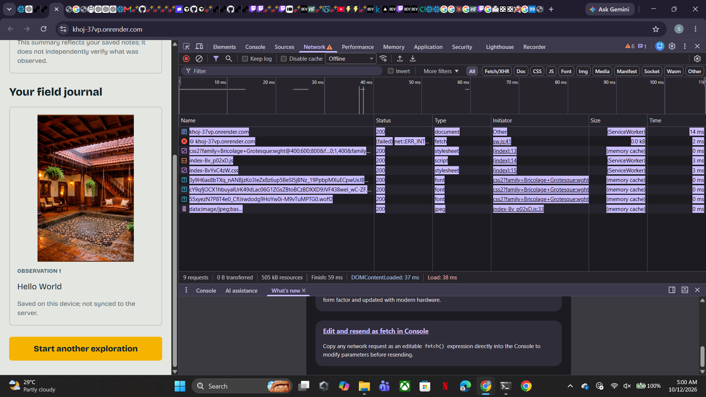

# Khoj (खोज)

> *Don't follow the map. Follow your curiosity.*

**Khoj** is an open-source, offline-first AI exploration companion for discovering the city around you. Starting with Mumbai, it offers curiosity-driven missions, lets you record what you notice, and helps you turn those observations into a personal field journal.

Built for the **Hacktoberfest 2026 Open-Source AI Challenge, Week 1: Touch Grass**.

**[Live Demo](https://khoj-37vp.onrender.com/)** · **[Source Code](https://github.com/Shanaya31/Khoj)**

Khoj doesn't tell you where to go. It gives you reasons to look around.

## Table of Contents

- [See Khoj in Action](#see-khoj-in-action)
- [How It Works](#how-it-works)
- [Offline-First Design](#offline-first-design)
- [AI and Fallback Behavior](#ai-and-fallback-behavior)
- [Run Locally](#run-locally)
- [Technical Architecture](#technical-architecture)
- [API Reference](#api-reference)
- [Current Limitations](#current-limitations)
- [Contributing](#contributing)
- [License](#license)

## See Khoj in Action

The following screenshots show the application and its exploration experience.




## How It Works

1. **Choose:** Select an exploration duration and an interest.
2. **Discover:** Receive a mission with prompts that encourage curiosity about your surroundings.
3. **Explore:** Head outside and record observations and notes.
4. **Reflect:** Finish your session and create a personal field journal grounded in your saved observations.

## Offline-First Design

Khoj is designed to keep exploration and progress available when internet connectivity is unreliable.

- **Cached app shell:** A service worker caches the application shell and static assets after an online visit.
- **Session persistence:** The active session and screen state are saved locally, allowing progress to survive a page refresh.
- **Local observations:** Observations are stored in browser storage.
- **Downloaded city packs:** City data can be cached on the device and used to build curated missions locally.
- **Fallback behavior:** The basic exploration experience does not require a running AI model.

### Offline Testing

The deployed application was tested using Chrome DevTools' Offline network setting. The tested mission-to-journal flow completed, and refreshing the page did not lose the active session or saved observations.

For the first offline session, open the app while online so the application assets and city pack can be cached.

Offline availability depends on previously cached assets and city data. Network-dependent features may still be unavailable without connectivity.

## AI and Fallback Behavior

Khoj supports **Gemma through Ollama** for local AI-assisted mission generation and related features when the model is available.

The hosted Render deployment runs with `KHOJ_LLM_MODE=off`. It uses curated missions and fallback behavior rather than hosting a Gemma model.

The model is an enhancement, never a requirement for the basic exploration experience.

## Run Locally

### Requirements

- Python 3.11+
- Node.js 20+
- [Ollama](https://ollama.com/) for local Gemma support
- Git

### Setup

Clone the repository:

```bash
git clone https://github.com/Shanaya31/Khoj.git
cd Khoj
